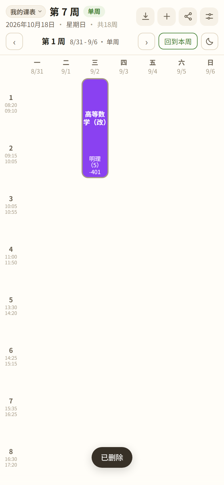
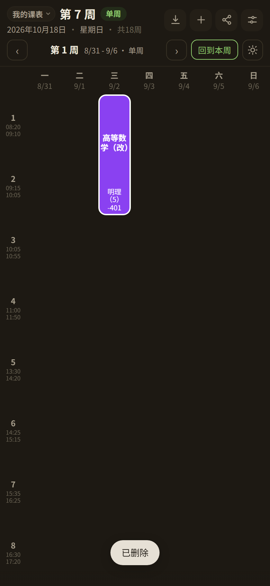
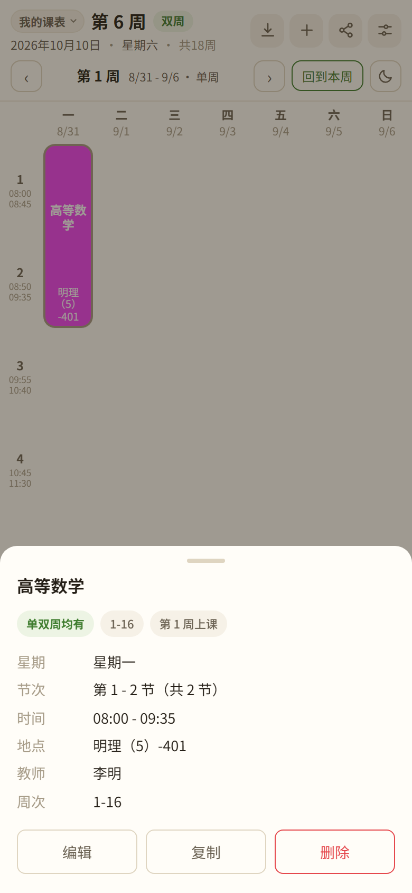
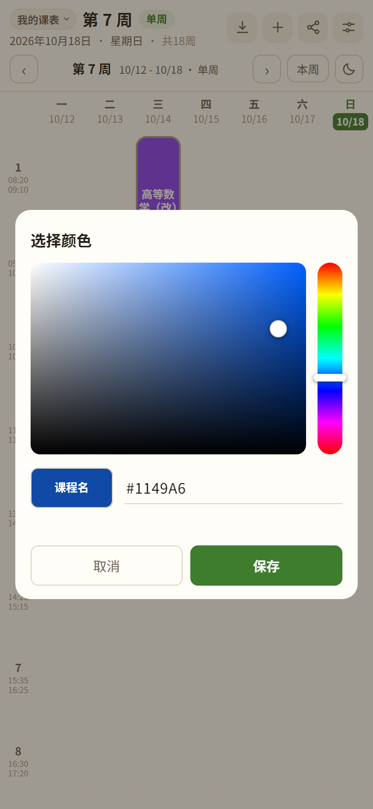
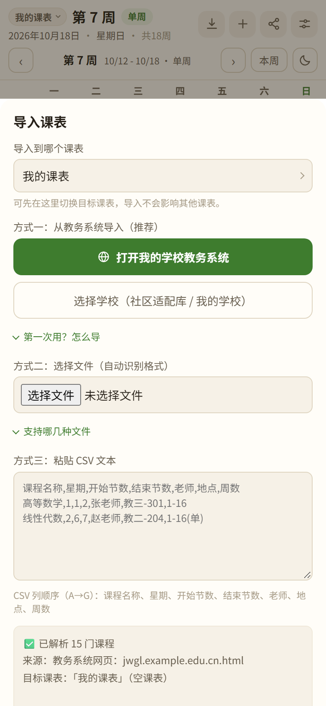
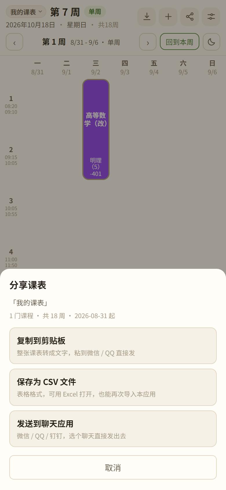
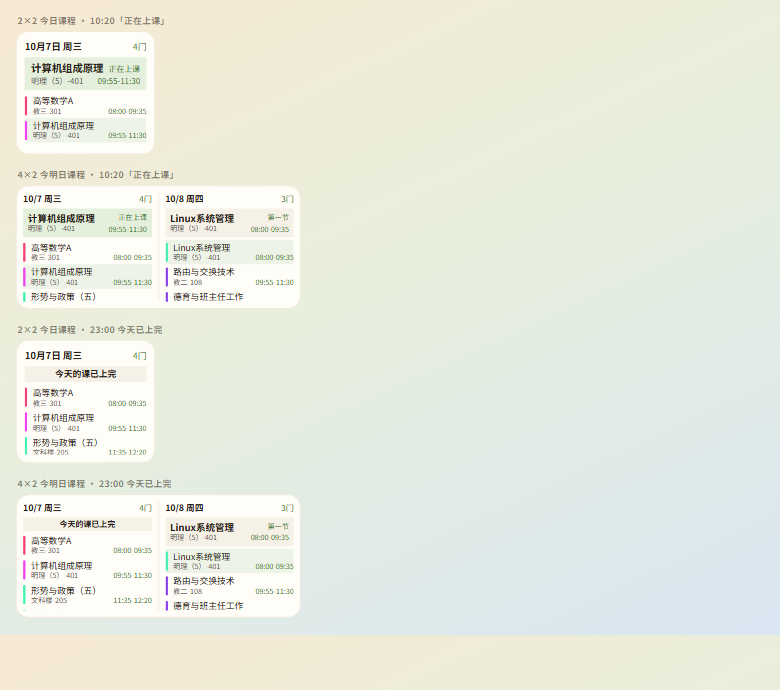

# 柚课 · 课程表 App

> 一个干净、离线、只属于你自己的手机课程表。

柚课把课表从**学校教务系统**或**学校下发的课表文件**里取回来，排成一张整洁的课表，装到手机上随手就能看。
课表数据全部保存在你自己的手机里，除了「从教务系统导入」这一步之外，**完全离线可用**，也不会向任何服务器上传数据。

- 应用名：**柚课**　·　包名：`cn.youke.schedule`　·　当前版本：**v1.9.46**
- 系统要求：**Android 8.0 及以上**（网页版支持任意现代浏览器）
- 面向用户申请的权限：**只有 `INTERNET`**（仅用于「从教务系统导入」）

<p align="center">
  
  
</p>

---

## 目录

- [一、它解决什么问题](#一它解决什么问题)
- [二、主要功能](#二主要功能)
- [三、安装](#三安装)
- [四、使用方法](#四使用方法)
- [五、课表格式说明](#五课表格式说明)
- [六、常见问题](#六常见问题)
- [七、隐私与安全](#七隐私与安全)
- [八、开源许可与致谢](#八开源许可与致谢)

---

## 一、它解决什么问题

每到开学，学生都得把课表「搬」到手机上，而这件事一直很麻烦：

- 教务系统只给一个网页，导出下来又是 `.xls` / `.pdf`，**一个学校一个样**；
- 抄进日历要手打一遍，改一次课还要再打一遍；
- 用别人的课表小程序 / 公众号，常常要求**授权登录、把学校和课表数据交给别人的服务器**。

**柚课要解决的就是这一件事**：把课表一次性取回来，排成一张干净、能随时改、完全离线可看的课表，装到手机上像本地应用一样用。围绕这一点，它有三条不变的主张：

- **数据不出本机**——课表存在手机本地，不注册、不登录、不上传。
- **权限只要一项**——面向用户申请的权限只有 `INTERNET`，且只在「从教务系统导入」时联网。
- **不模拟登录、不保存账号密码**——从教务导入时，应用内嵌一个真浏览器，**由你自己登录**、自己翻到课表页，它只把课表取回来。

> **使用范围**：本项目定位为**自用 / 课程作业 / 小范围分享**，**不上架应用商店、不收费、不投放广告**（原因见[第八节](#八开源许可与致谢)）。

## 二、主要功能

### 看课表

- 周一至周日 7 列排版，左侧是节次时间列；顶部显示「年月日 + 星期几 + 当前第几周 + 单/双周」。
- **一屏最多 8 节课**（不足 8 节则铺满），第 9 节起上下滑动查看；行高按屏幕高度自动计算，转屏自动重排。
- **左右滑动切换周**，也可用周次栏的 ‹ › 与「本周」按钮。
- 表头的**今天**用高亮块标出；**点击课程卡片**弹出详情：星期、节次、上课时间、地点、教师、周次与单双周。
- 同一时段有多门课时自动**并排显示**；课程卡片按课名**自动配色**，也可手动指定颜色。

<p align="center">
  
  
</p>

### 导入课表（四种来源）

- **从教务系统导入**（推荐）：应用内嵌真浏览器，你自己登录后一键取回课表；内置社区适配脚本的学校可一键完成，其余学校走教务系统自己的「导出 / 下载课表」，下载会被自动接住并导入。
- **导入学校下发的文件**：`.xls` / `.xlsx` / `.pdf` / `.html`（含伪装成 `.xls` 的网页表格）。程序**按文件内容自动识别真实格式**，不看扩展名。
- **粘贴 CSV 文本**：按 A→G 列解析，支持 UTF-8 与 GBK 编码。

导入时会自动：合并被表格拆到相邻节次行的同一门课、去除完全重复的条目、按课表内容放宽周数 / 每天节数上限，并对无法定位时间的实践课程单独提示。导入前会弹**预览**（多少门课、来自哪个域名、导入到哪份课表），再选**覆盖**或**追加**。

<p align="center">
  
</p>

### 管理与自定义

- **手动添加 / 编辑 / 复制 / 删除课程**；「编辑」复用「添加」表单，保存即就地生效。
- **多课表**：可新建、切换、重命名、复制、删除；每份课表**各自独立保存课程与学期设置**（开学日期、总周数、节数、作息时间）。
- **设置**：
  - 界面主题：白天 / 夜晚 / 跟随系统；
  - 上课时间表：固定上课时长开关、每节课时长、逐节起止时间、添加 / 左滑删除某一节 / 恢复默认；
  - 备份与恢复：把全部课表与设置导出成一个 `.json` 文件，或从该文件恢复；
  - 清空当前课表。

### 分享与导出

- **复制成一段文字**：按星期分组、按节次排好，直接粘进聊天窗口发给同学。
- **保存为 CSV 文件**：能用 Excel 打开，也能**再导回本应用**（与导入端同序，开头带 BOM）。
- **直接发到微信 / QQ / 钉钉**：发出的是一份 `.csv` 附件；「其他应用」走系统分享面板。

<p align="center">
  
</p>

### 桌面小组件

- **2×2 今日课程**与 **4×2 今明日课程**两种组件（4×2 的课程列表可上下滑动）。

<p align="center">
  
</p>

## 三、安装

有三种方式，按需选一种即可。

### 方式一：安装 APK（最省事）

1. 取得安装包 `柚课-v1.9.46.apk`（Release 版，推荐）；
2. 用微信 / QQ / 数据线把它传到手机；
3. 在手机上点击安装。若提示「未知来源应用」，在系统设置里允许该来源安装即可。

也可以命令行安装（手机需先开启「开发者选项 → USB 调试」）：

```bash
adb install -r 柚课-v1.9.46.apk
```

> 安装时**不会出现定位 / 通讯录 / 存储等权限弹窗** —— 面向用户申请的权限只有 `INTERNET` 一项。

### 方式二：自己构建 APK

需要 **JDK 21** 与 **Android SDK**。在项目根目录依次执行：

```bash
node tools/sync-assets.js     # 把 web/ 同步进 android 的资源目录
tools\build-apk.bat           # 双击或命令行运行，Debug + Release 一起出
```

也可以直接用 Android Studio 打开 `android/` 目录，然后 ▶ Run。

> 构建脚本里写死了本机环境路径（`JAVA_HOME`、`ANDROID_HOME`），换机器时改这两行即可。
> 工程路径含中文时，已通过 `gradle.properties` 里的 `android.overridePathCheck=true` 处理。

### 方式三：网页版（免安装）

用浏览器直接打开 `web/index.html` 就能体验。想用手机看：把 `web/` 整个目录放到任意静态服务器上，手机连同一 WiFi 访问即可；用浏览器菜单「添加到主屏幕」后，会以类原生方式全屏运行（名字和图标都取自应用清单）。

> 网页版可以体验看课表、选文件 / 粘贴导入、添加课程、分享等功能；但**「从教务系统导入」需要手机 App 里的内嵌浏览器**，在网页版里点它会给出提示。

## 四、使用方法

### 1. 先把课表导进来

点顶栏的**导入**按钮，三种方式任选其一：

1. **从教务系统导入**：点「方式一」的**「打开我的学校教务系统」**（第一次会先带你去选一次学校，没用过任何学校时也可手动填教务地址）→ 在应用内的浏览器里**自己登录** → 有适配脚本的学校点底部「执行导入」即可；没有脚本的学校，点教务系统自己的「导出 / 下载课表」，下载会被自动接住并导入。导入前会弹预览，点「覆盖导入」或「追加导入」落到某一份课表里。
2. **选文件导入**：点「方式二」，选中学校下发的 `.xls` / `.xlsx` / `.pdf` / `.html`，程序自动识别格式。
3. **粘贴 CSV**：点「方式三」，把 CSV 文本粘进框里，点「解析粘贴内容」。

> 在电脑浏览器里体验时，可先拿 `tools/fixtures/示例课表.csv` 试一遍（⚠️ 手机 App 里访问不到这个文件，请直接选手机上的课表文件）。

### 2. 日常使用

| 想做什么 | 怎么做 |
| --- | --- |
| 切换周次 | 在课表区左右滑动，或用周次栏的 ‹ › 与「本周」按钮 |
| 看课程详情 | 点任意课程卡片；详情弹层**按住往下拖**即可关闭 |
| 添加课程 | 点顶栏的 **＋**（编辑复用同一套表单，保存即生效） |
| 换白天 / 夜晚 | 点周次栏最右的月亮 / 太阳图标（也可在设置里选「跟随系统」） |
| 分享课表 | 点顶栏**分享** → 复制成文字 / 保存为 CSV / 发到微信·QQ·钉钉 |
| 管理多份课表 | 点顶栏课表名 → 新建 / 切换 / 重命名 / 复制 / 删除 |
| 改作息时间 | 设置 →「上课时间表」 |

### 3. 桌面小组件

在手机桌面长按空白处 → 添加小部件 → 找到「柚课」，选 **2×2 今日课程**或 **4×2 今明日课程**。

### 4. 换手机怎么搬家

- **设置 → 备份与恢复 → 导出全部数据**：会生成一个 `.json` 文件，里面是**全部课表 + 每份课表的设置**；
- 在新手机上用**从备份恢复**读入该文件即可。
- 若手机开启了系统云备份 / 换机迁移，课表也会随系统备份一起同步到新机。

## 五、课表格式说明

### 5.1 支持的导入来源

| 来源 | 格式 | 打开方式 |
| --- | --- | --- |
| **学校教务系统（推荐）** | — | 导入面板 →「打开我的学校教务系统」→ 自己登录 → 执行导入 / 教务的导出下载 |
| 教务系统「导出课表」下的文件 | `.html`，或伪装成 `.xls` 的网页表格 | 「导入课表」→ 选择文件（也可在内嵌浏览器里直接点教务的导出按钮） |
| 教务处下发的班级课表 | `.xls`（Excel 97-2003）/ `.xlsx` | 「导入课表」→ 选择文件 |
| 教务系统下载的个人课表 | `.pdf` | 「导入课表」→ 选择文件 |
| 自行整理的课表 | `.csv`（UTF-8 或 GBK） | 选择文件，或粘贴文本 |

程序按**内容**判断真实类型（`D0CF11E0`=xls、`PK`=xlsx、`%PDF`=pdf、开头像 HTML=网页），所以扩展名被改过、或从网页直接下载成 `.ashx` / `.do` 之类的文件也能正常导入。

### 5.2 CSV 列顺序（A→G）

| 列 | 含义 | 示例 | 说明 |
| --- | --- | --- | --- |
| A | 课程名称 | `高等数学A` | 必填，为空则该行跳过 |
| B | 星期 | `1` / `周一` / `Mon` | 1=周一 … 7=周日；支持「星期一」「周三」「0=周日」等写法 |
| C | 开始节数 | `1` | 必填 |
| D | 结束节数 | `2` | 留空则与开始节数相同 |
| E | 老师 | `张建国` | 选填 |
| F | 地点 | `教三-301` | 选填 |
| G | 周数 | `1-16` | 支持多种写法，见下 |

**周数（G 列）支持的写法：**

| 写法 | 含义 |
| --- | --- |
| `1-16` | 第 1 到 16 周（每周都有） |
| `1-16(单)` / `1-15单` / `单周` / `单` | 仅单周上课 |
| `2-16(双)` / `2-16双` / `双周` / `双` | 仅双周上课 |
| `1,3,5` | 指定第 1、3、5 周 |
| `1-8,10-16` | 多段区间（CSV 中需加引号：`"1-8,10-16"`） |
| `1月16日` / `5月8日` | **Excel 日期化损坏格式，自动还原**（原意为 1-16、5-8） |
| 留空 / `全周` | 整个学期 |

首行若是表头（含「课程」「星期」等字样）会自动跳过；Excel 导出的 GBK 编码文件也会自动识别，无需手动转换。

## 六、常见问题

**Q：从教务系统导入时，提示「没识别到课程」或识别不全？**
最常见的原因是教务课表页**没显示上课时间 / 教室 / 教师**。请到课表页的**显示设置（一般是页面上的齿轮图标）**，打开这些列的显示，再重新导入。
另外，如果学校用的是不常见的课表页面结构，也可能识别失败——可以改用**导入学校下发的文件**这条路。

**Q：手机上导入文件时，怎么找不到示例课表？**
`tools/fixtures/` 里的示例文件只在电脑上用于测试，**不会装进手机 App**，请直接选你自己手机上的课表文件。

**Q：导出的 CSV 文件还能再导回来吗？**
能。分享 / 导出的 CSV 与导入端**同序同口径**，可以原样再导入。

**Q：这个应用会联网吗？**
只有「从教务系统导入 / 载入适配库」时会联网。看课表、添加课程、分享等其余功能**完全离线**。

**Q：会保存我的教务账号密码吗？**
不会。导入是在**你自己登录**的页面上进行的，应用不模拟登录、不保存账号密码。

**Q：换手机数据会丢吗？**
用**设置 → 备份与恢复**导出 / 恢复即可；开启系统云备份的手机也会随之同步。

**Q：课程卡片颜色能改吗？**
可以。添加 / 编辑课程时可以选「自动」（按课名配色），也可以打开调色盘自己取色。

**Q：支持哪些手机？**
Android 8.0 及以上；网页版支持任意现代浏览器。

## 七、隐私与安全

- **数据存在哪**：课表存在手机本地（应用内 WebView 的本地存储），不上传任何服务器。
- **权限**：面向用户申请的权限**只有 `INTERNET`** 一项，仅用于从教务系统导入。
- **不碰账号密码**：不模拟登录、不做 RPA 填表、不保存账号密码；导入时你登录的是**学校教务系统自己的页面**。
- **适配脚本**：内置的社区适配库取自上游 **MIT 许可**的公开仓库，只在运行时下载（清单与脚本都不随安装包分发），不镜像、不修改、不代上游分发。
- **已知的设计取舍**（不是遗漏，在此如实说明）：
  - 为兼容仍使用 http 的校内教务，清单允许明文连接；
  - 为方便换机，课表可随手机系统云备份同步（交给手机自己的备份体系）。

## 八、开源许可与致谢

### 许可证

本项目以 **[MIT](LICENSE)** 许可开源（Copyright © 2026 YunYou1128）：可自由使用 / 修改 / 再分发 / 商用（在保留版权声明与免责声明的前提下）。

### 知识产权声明

- 本项目为**独立开发**。全部代码——含自研 HTML 解析器、课表提取器、四种课表文件格式解析——均为自行编写，**未使用任何第三方应用的代码、资源或数据集**。
- **地址簿不内置任何学校的教务地址**：出厂时地址簿为空，地址由使用者自己填写、只存在他自己手机上。
- 社区适配库通道取的是上游 MIT 仓库**公开分发**的内容，只在运行时下载、不随包分发、不代上游分发。
- 解析对象是**用户本人正在浏览的教务页面**，不模拟登录、不保存账号密码。
- 本项目与任何第三方课表应用无隶属或关联关系。

### 使用范围与商标

本项目的定位是**自用 / 课程作业 / 小范围分享**——**不上架应用商店、不投放广告、不收费**。
经核查，「柚课」在第 9 类（含「可下载的手机应用软件」）**已有在先注册商标**，因此**请勿将本项目上架应用商店或用于商业推广**。

### 致谢

- 社区教务适配库来自上游开源项目 [ShiGuangSchedule/shiguang_warehouse](https://github.com/ShiGuangSchedule/shiguang_warehouse)（MIT 许可），感谢原作者与各校维护者。

---

## 附：项目结构

```
.
├─ web/                  # 应用主体（原生 HTML/CSS/JS，零第三方依赖），可直接用浏览器打开
├─ android/              # Android Studio 工程（Kotlin + WebView 壳）
├─ tools/                # 构建与测试脚本（打包、冒烟、解析测试、截图等）
├─ docs/                 # 截图与图标源资产
├─ remotion-videos/      # 宣传视频的源码工程（只含源码，不含渲染产物）
├─ 柚课图标_assets/       # 图标设计源文件
├─ LICENSE
├─ README.md
└─ 柚课使用教程与注意事项.md
```

- 想了解每个功能的设计取舍与历次版本变更，可查阅源码内注释与测试脚本（`tools/`）。
- 更细的**使用说明与注意事项**（权限口径、数据存在哪、换机怎么搬、导入失败排查）见 [`柚课使用教程与注意事项.md`](柚课使用教程与注意事项.md)。
- 源码注释与脚本里偶尔会出现 `留档/…`、`发布前合规自查清单.md`、`体检报告-*.md` 这类路径。
  它们都列在 `.gitignore` 里，是**维护者本机笔记**（历次删掉的功能源码备份、合规与体检记录），
  **未随本仓库公开**——按注释去找不到属于正常。保留这些引用，是为了让维护者在自己的机器上照常翻查；
  想知道某个引用指向什么，看 `.gitignore` 里对应的那一组注释即可。
